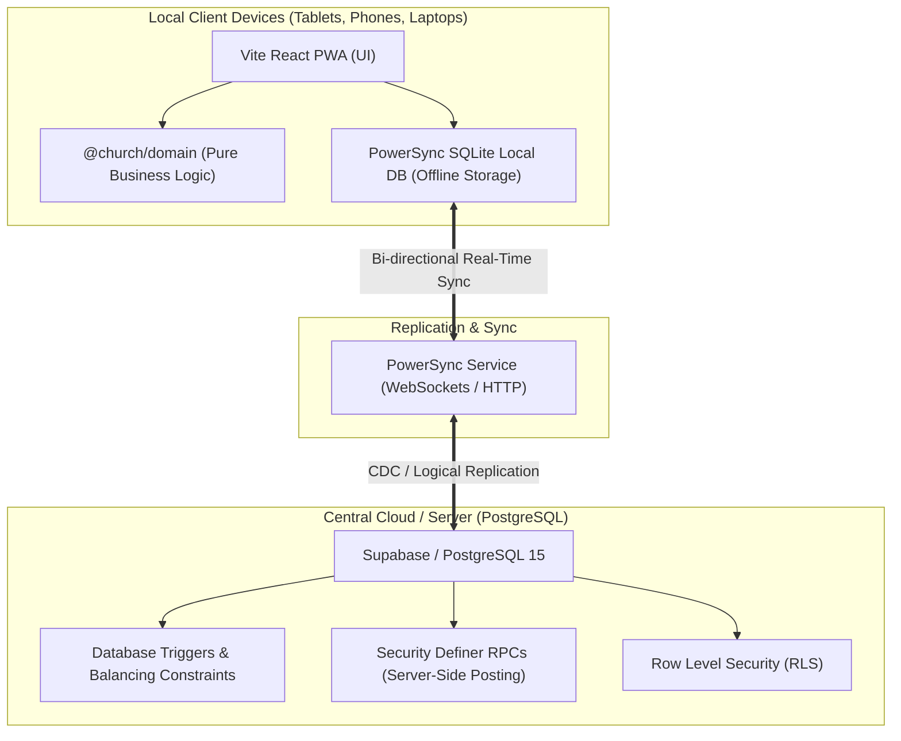

# Church Accounting System — Deployment & Operations Guide
**Church of Christ International, Accra (CCIA)**  
*Production Deployment, Infrastructure Setup & Disaster Recovery*

---

## 1. Architecture Overview

The CCIA Church Accounting System is built on an **Offline-First, Zero-Trust Accounting Architecture**:



### Core Infrastructure Principles
- **No Client Trust**: The local client is never trusted to enforce accounting balancing or authorization rules. Database constraints and server-side RPC functions reject unbalanced postings.
- **Offline Autonomy**: Every device maintains an SQLite database containing the chart of accounts, funds, budgets, and journal history. Queries run directly against local SQLite in `<15ms`.
- **Paid Tier / Dedicated Server Required**: In accordance with the system specification, **never use free-tier database hosting** (e.g. free Supabase instances that pause after periods of inactivity). Finance systems require continuous availability.

---

## 2. Option A: Managed Cloud Deployment (Recommended)

This is the fastest, most reliable setup with zero server maintenance, automated failover, and global PWA delivery.

### 1. Central Database: Supabase Pro
1. Create a project on [Supabase.com](https://supabase.com) on the **Pro Plan** (to avoid auto-pausing).
2. Choose the nearest region (e.g., `eu-west-1` Ireland or `af-south-1` Johannesburg).
3. In the Supabase SQL Editor, execute the migration scripts located in `packages/db/supabase/migrations/` in numerical order:
   - `20261101000000_core_tables.sql`
   - `20261101000001_constraints_and_triggers.sql`
   - `20261101000002_rls_policies.sql`
   - `20261101000003_seed_data.sql`
   - `20261101000004_rpc_posting_functions.sql`

### 2. Synchronization Engine: PowerSync Cloud
1. Create an account on [PowerSync.com](https://powersync.com).
2. Connect PowerSync to your Supabase PostgreSQL instance using the Supabase connection string.
3. In the PowerSync dashboard, navigate to **Sync Rules** and paste the content of `packages/db/powersync/sync_rules.yaml`.
4. Deploy the sync rules. PowerSync establishes a continuous logical replication stream.

### 3. Static PWA Hosting: Cloudflare Pages / Vercel
1. Link your GitHub repository (`https://github.com/Nanakay62/ccia.git`) to Cloudflare Pages or Vercel.
2. Configure build settings:
   - **Framework Preset**: Vite
   - **Build Command**: `pnpm build`
   - **Output Directory**: `apps/web/dist`
   - **Node.js Version**: `20.x` or higher
3. Add Environment Variables:
   - `VITE_SUPABASE_URL`: `https://<your-project>.supabase.co`
   - `VITE_SUPABASE_ANON_KEY`: `<your-anon-key>`
   - `VITE_POWERSYNC_ENDPOINT`: `https://<your-instance>.powersync.journeyapps.com`
4. Deploy! Your PWA will be globally distributed on edge CDNs with automatic HTTPS and service worker caching.

---

## 3. Option B: Self-Hosted Docker VPS Deployment

For complete data sovereignty on church-owned hardware or a private VPS in Ghana.

### Hardware Requirements
- **Server**: 2 vCPU, 4GB RAM, 40GB SSD (Ubuntu 22.04 LTS or 24.04 LTS).
- **Network**: Static Public IPv4, Ports 80 and 443 open.

### Step-by-Step Installation

1. **Clone the Repository**:
   ```bash
   git clone https://github.com/Nanakay62/ccia.git /opt/ccia
   cd /opt/ccia
   ```

2. **Configure Environment Variables**:
   ```bash
   cd deploy
   cp .env.example .env
   nano .env
   ```
   *Ensure you update `POSTGRES_PASSWORD`, `POWERSYNC_JWT_SECRET`, and `BACKUP_PASSPHRASE` with long, random strings.*

3. **Build the PWA Distribution**:
   ```bash
   cd /opt/ccia
   pnpm install --frozen-lockfile
   pnpm build
   ```

4. **Launch the Docker Compose Stack**:
   ```bash
   cd /opt/ccia/deploy
   docker compose up -d
   ```

5. **Verify Running Containers**:
   ```bash
   docker compose ps
   ```
   You should see:
   - `ccia_postgres`: PostgreSQL 15 database (healthy)
   - `ccia_powersync`: PowerSync sync engine running on `:8080`
   - `ccia_web`: Nginx serving the PWA and reverse proxying WebSockets
   - `ccia_backup`: Alpine container running the automated encrypted backup cron

6. **Install SSL Certificate with Certbot**:
   ```bash
   sudo apt update && sudo apt install -y certbot python3-certbot-nginx
   sudo certbot --nginx -d accounting.yourchurchdomain.org
   ```

---

## 4. Automated Encrypted Backups & Disaster Recovery

The system takes automated, encrypted database dumps every night at 02:00 AM UTC (Accra Time is GMT/UTC year-round).

### How the Backup Service Works (`deploy/backup-cron.sh`):
1. Dumps the full PostgreSQL ledger via `pg_dump`.
2. Compresses the SQL file with `gzip -9`.
3. Encrypts the archive using **AES-256-CBC with PBKDF2** (100,000 key iterations) using `$BACKUP_PASSPHRASE`.
4. Saves the encrypted file to `/backups/ccia_backup_YYYYMMDD_HHMMSS.sql.gz.enc`.
5. Prunes backup files older than 30 days.

### Disaster Recovery: Restoring from an Encrypted Backup
If the server suffers catastrophic disk failure:

1. **Decrypt the Backup Archive**:
   ```bash
   openssl enc -d -aes-256-cbc -pbkdf2 -iter 100000 \
     -in /backups/ccia_backup_20261101_020000.sql.gz.enc \
     -out restored_dump.sql.gz \
     -pass pass:"YourSecureChurchPassphrase"
   ```

2. **Uncompress and Restore into PostgreSQL**:
   ```bash
   gunzip -c restored_dump.sql.gz | docker exec -i ccia_postgres psql -U postgres -d ccia_accounting
   ```

3. **Verify Ledger Balance with TB Doctor**:
   Log into the PWA and navigate to **General Ledger** $\rightarrow$ **Trial Balance** $\rightarrow$ **Check & Diagnose Books**. The doctor will verify that all restored accounts balance to zero.

---

## 5. Device Onboarding & PWA Installation Guide

The CCIA Accounting System is an installable Progressive Web App (PWA) designed to function like a native mobile or desktop application.

### On Android (Phones & Tablets)
1. Open Google Chrome and navigate to the church accounting URL (e.g., `https://accounting.yourchurchdomain.org`).
2. Chrome will display a banner at the bottom: **"Add CCIA Accounting to Home screen"**.
3. If the banner does not appear, tap the three dots menu ($\vdots$) in the top right corner and select **Install App** or **Add to Home screen**.
4. Confirm the installation. An official CCIA app icon appears on your home screen and drawer.
5. Launch the app from the home screen icon. It runs full-screen without URL bars or browser chrome.

### On iOS (iPads & iPhones)
1. Open Apple Safari and navigate to the church accounting URL.
2. Tap the **Share** button (the square icon with an upward arrow at the bottom or top of the screen).
3. Scroll down and tap **Add to Home Screen**.
4. Tap **Add** in the top right corner.
5. The CCIA app icon is now installed on your iPad or iPhone home screen.

### On Windows / Mac Laptops
1. In Google Chrome or Microsoft Edge, look at the right side of the address bar.
2. Click the **Install** icon (a computer monitor with a small down arrow).
3. Click **Install**. The application opens in its own dedicated, native desktop window.

### Verifying Offline Readiness
To confirm a device is ready for offline Sunday counting:
1. Open the installed app while connected to Wi-Fi.
2. Log in with your PIN.
3. Turn on **Airplane Mode** (or disable Wi-Fi/data).
4. Notice the header status badge updates to 🟡 **Offline (Queue Active)**.
5. Navigate through the Chart of Accounts, Trial Balance, and Member Directory.
6. Record a draft Counting Sheet or Payment Voucher.
7. Turn off Airplane Mode. The status badge turns 🟢 **Online (Synced)**, and the sync indicator confirms all records synced.
