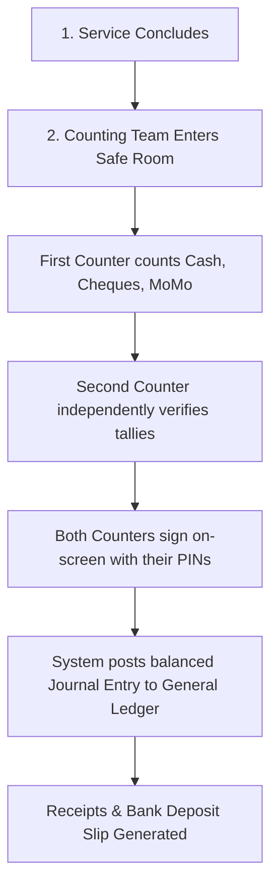
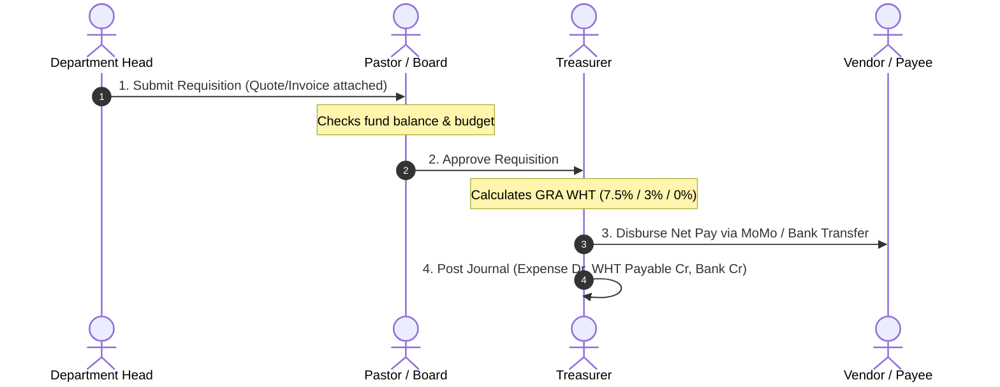

# Church Accounting System — User Guide
**Church of Christ International, Accra (CCIA)**  
*Accra Main Branch — Offline-First PWA Accounting System*

---

## 1. Introduction & Overview

Welcome to the CCIA Church Accounting System. This software was purpose-built for the unique accounting, financial governance, and compliance needs of our local congregation in Accra, Ghana.

### Key Principles

1. **Books in Ghana Cedis (GHS), Denominational Reporting in USD**:
   The church’s day-to-day books, banking, payroll, and statutory tax obligations are strictly recorded in Ghana Cedis (**GHS**). Foreign currency receipts (such as USD cash, cheques, and foreign donor contributions) are tracked with their original currency amounts and exchange rates, with consolidated reports available in both GHS and USD.

2. **Works Fully Offline**:
   Internet connectivity in Accra can be unpredictable. You can perform every core task—counting Sunday offerings, issuing payment vouchers, running payroll, and viewing financial statements—without an internet connection. When your device reconnects to Wi-Fi or mobile data, all changes sync automatically and securely with the central server.

3. **Strict Financial Integrity & Segregation of Duties**:
   - No single person can count, approve, and disburse church funds alone.
   - Dual sign-off is enforced on all counting sheets.
   - Closed accounting periods are permanently locked against changes.
   - Journal entries are append-only. Mistakes are corrected transparently via linked reversal entries.

---

## 2. User Roles & Permissions

Every staff member or volunteer is assigned a specific role that limits what they can see and do:

| Role | Permitted Actions | Member Privacy |
| :--- | :--- | :--- |
| **Pastor / Lead Minister** | Approve expense requisitions, view church-wide financial reports, budgets, and fund summaries. Cannot disburse funds or count cash alone. | Names masked by default |
| **Treasurer** | Authorize payment vouchers, manage bank/cash accounts, enter exchange rates, run month-end revaluations, lock periods, and process payroll. | Full Access |
| **Finance Elder / Auditor** | Full read-only audit access across all journals, counting sheets, bank reconciliations, and the Trial Balance Doctor. | Full Access |
| **Financial Secretary** | Maintain member roll, envelope numbering, pledge tracking, enter tithe/offering receipts, issue official statements. | Full Access |
| **Counting Team (Volunteers)** | Input Sunday cash denomination tallies, record cheque and MoMo counts, dual-sign counting sheets. Cannot edit general ledger accounts. | Names Masked (`MEM-***`) |
| **Department Head** | Submit expense requisitions for youth, women's, men's, or music ministries against approved budgets. | No access to giving |

---

## 3. Sunday Counting Sheet Workflow

Sunday giving (Tithes, General Offering, Building Fund, Missions, and Welfare) must follow our strict four-step dual-custody procedure.

### Step-by-Step Instructions:

1. **Open the Counting Sheet**:
   - Log in and navigate to **Giving & Collections** $\rightarrow$ **Sunday Counting**.
   - Click **+ New Counting Sheet**.
   - Select the service date (default is today) and service type (*1st Service*, *2nd Service*, or *Joint Service*).

2. **Record Cash Denominations (GHS & USD)**:
   - For Ghana Cedis, enter the physical piece count for each note and coin:
     - GHS 200, GHS 100, GHS 50, GHS 20, GHS 10, GHS 5, GHS 2, GHS 1, and 50 Pesewas coins.
   - For US Dollars, enter the count for USD 100, 50, 20, 10, 5, and 1 notes.
   - The system automatically calculates the exact mathematical total.

3. **Enter Cheques & Mobile Money (MoMo)**:
   - Enter all cheques with the Bank Name, Cheque Number, Drawer Name, and Amount.
   - Record MoMo collections with the Network (MTN MoMo, Telecel Cash, AT Money), Transaction Reference ID, and Amount.

4. **Fund Allocations**:
   - Allocate the total collection across church funds:
     - **General Fund** (Tithes, Regular Offerings)
     - **Building Fund** (Dedicated infrastructure/expansion pledges)
     - **Missions & Outreach** (Evangelism and rural church planting)
     - **Welfare / Benevolence** (Member medical & bereavement assistance)
   - *Note*: The sum of fund allocations must exactly equal the physical cash + cheque + MoMo total.

5. **Dual Sign-Off (Segregation of Duties)**:
   - **First Counter**: Reviews the breakdown, signs on the screen, and clicks **Sign as 1st Counter**.
   - **Second Counter**: Must be an unrelated church member. The system blocks the same person from signing both slots. The second counter verifies the cash count, signs on screen, and clicks **Co-sign & Submit**.
   - The sheet status updates to **POSTED**, automatically creating balanced journal entries in the ledger.

---

## 4. Expense Requisitions & Payment Vouchers

Church funds are disbursed using a three-stage authorization process with statutory Ghana Revenue Authority (GRA) Withholding Tax (WHT) deduction.

### Step-by-Step Instructions:

1. **Submitting a Requisition**:
   - Navigate to **Expenditure** $\rightarrow$ **New Requisition**.
   - Choose your Department (*Youth*, *Children*, *Evangelism*, *Media*, *Welfare*).
   - Select the target expense account (e.g., `5110 Utilities`, `5130 Maintenance`, `5140 Welfare`).
   - Select the funding source (General Fund, Welfare Fund, etc.). The system displays the current available balance to prevent overspending.
   - Enter description, payee name, and requested amount.
   - Click **Submit for Approval**.

2. **Pastoral / Board Approval**:
   - The Pastor or designated Elder opens **Expenditure** $\rightarrow$ **Pending Approvals**.
   - Reviews the requisition details and verifies budget availability.
   - Clicks **Approve Requisition** (or **Reject** with a recorded comment).

3. **Treasurer Payment Voucher & Withholding Tax (WHT)**:
   - The Treasurer opens approved requisitions and clicks **Create Payment Voucher**.
   - Select the disbursement payment source:
     - `1010 Cash on Hand (GHS)`
     - `1030 Main Bank Account (GHS)`
     - `1050 Mobile Money Float`
   - Select the applicable Ghana WHT rate:
     - **Services (Standard GRA Rate)**: 7.5% WHT deducted
     - **Goods & Supplies**: 3% WHT deducted
     - **Exempt / Petty Cash / Internal Reimbursement**: 0% WHT
   - The system automatically calculates:
     $$\text{Net Payable} = \text{Gross Amount} - \text{WHT Amount}$$
   - The Treasurer clicks **Authorize & Disburse**. The system generates an official Voucher Number (e.g., `PV-2026-0042`) and posts:
     - **Debit**: Expense Account (`5xxx`) for Gross Amount
     - **Credit**: WHT Payable Account (`2020`) for WHT Amount
     - **Credit**: Cash / Bank / MoMo Account (`1xxx`) for Net Amount

---

## 5. Month-End Closing & Foreign Currency (USD) Revaluation

At the end of each calendar month, the Treasurer conducts the month-end closing routine.

### 1. Run the Trial Balance Doctor
Before closing any period, the books must balance.
- Navigate to **General Ledger** $\rightarrow$ **Trial Balance**.
- Click **Check & Diagnose Books**.
- Ensure the status badge displays **GREEN: Books are in perfect balance**.

### 2. Enter Month-End Closing Exchange Rate
- Navigate to **Currency & FX** $\rightarrow$ **Exchange Rates**.
- Enter the Bank of Ghana / Commercial Bank closing rate for USD $\rightarrow$ GHS for the final day of the month (e.g., `1 USD = 15.80 GHS`).
- Provide the rate source reference (e.g., *Bank of Ghana Interbank Closing Rate*).

### 3. Run Foreign Currency Revaluation
Foreign currency bank balances (Account `1040 Bank USD`) and cash holdings (`1020 Cash USD`) must be revalued to reflect accurate Cedi values on the balance sheet:
- Click **Run Month-End Revaluation**.
- Review the **Revaluation Preview**:
  - The preview shows each foreign account's original USD balance, current book value in GHS, new revalued amount at the closing rate, and the resulting **Unrealized Gain or Loss**.
- Click **Confirm & Post Revaluation Entry**.
- The system automatically creates a journal entry posting the difference to Account `5980 Foreign Exchange Gain/Loss`.

### 4. Lock the Accounting Period
- Navigate to **Settings & Controls** $\rightarrow$ **Accounting Periods**.
- Locate the completed month and click **Close & Lock Period**.
- Once locked, no user—including the Treasurer—can post new transactions, edit vouchers, or delete entries within that month.
- *Any subsequent adjustments must be made in the open current period via an authorized linked reversal entry.*

---

## 6. Trial Balance Doctor — Troubleshooting Discrepancies

The **Trial Balance Doctor** is the system’s automated diagnostic engine. It runs 10 sequential checks to verify ledger integrity:

| Check # | Focus Area | Description |
| :--- | :--- | :--- |
| **Rule 1** | Mathematical Balance | Verifies that church-wide Debits equal Credits in GHS. |
| **Rule 2** | Fund Balance | Ensures every fund (General, Building, Welfare, Missions) balances independently. |
| **Rule 3** | Structural Integrity | Detects orphaned lines, missing headers, zero or negative amounts. |
| **Rule 4** | Sync Integrity | Detects incomplete sync batches (missing lines compared to `line_count`). |
| **Rule 5** | Currency & Rounding | Checks that base GHS amounts match original USD $\times$ rate, identifying 1-pesewa rounding variances. |
| **Rule 6** | Duplicate Entries | Flags entries posted with the same date, amount, fund, and user within 15 minutes. |
| **Rule 7** | Pattern Diagnostics | Calculates remaining difference $D$: checks for transposed digits ($D \div 9$), inverted debit/credit ($D \div 2$), or currency slips ($10\times$ or $100\times$). |
| **Rule 8** | Time Bisect | Pinpoints the exact calendar day when the ledger first fell out of balance. |
| **Rule 9** | Device & User Grouping | Identifies if discrepancies originate from a specific phone, tablet, or user account. |
| **Rule 10** | Opening Balances | Verifies that beginning balances from previous years balance independently. |

### Diagnostic Findings & Corrective Action
> [!IMPORTANT]
> **The System Never Auto-Fixes Books**:
> Silent automated corrections are forbidden in sound church accounting. If the Doctor flags an error:
> 1. Read the plain-language finding (e.g., *"Entry JE-2026-0112 has GHS 500.00 debit to 1010 and GHS 450.00 credit to 4010. Difference: GHS 50.00"*).
> 2. Click the link to view the flagged entry.
> 3. Click **Create Linked Reversal Entry** to cancel the flawed entry with an exact mirror.
> 4. Post a clean, balanced replacement entry.

---

## 7. Member Giving Statements & Receipts

Member tithes and building contributions are strictly confidential.

### Privacy Safeguards
- Non-finance volunteers cannot see member names; records show tokenized identifiers (e.g., `MEM-042`).
- Financial Secretaries and the Treasurer see full names, contact info, and annual giving history.

### Issuing Annual Statements & Receipts:
1. Navigate to **Giving & Collections** $\rightarrow$ **Member Directory**.
2. Search by member name, phone number, or envelope number (e.g., `ENV-012`).
3. Click on the member profile to open their giving dashboard.
4. Select the reporting period (e.g., *Current Tax Year 2026*, *First Half 2026*, or custom dates).
5. Click **Generate Official Statement**:
   - **Download PDF**: Generates a tamper-evident, formatted PDF statement bearing the church's official letterhead, branch address, total tithes, building fund contributions, and auditor sign-off block.
   - **Export Excel / CSV**: For audit and year-end reporting.
   - **Single Receipt**: Click the receipt icon next to any specific offering entry to print or save a one-off tax receipt.

---

## 8. Church Staff Payroll

The system includes a Ghana-compliant payroll module for pastors, administrators, caretakers, and music staff.

### Statutory Deductions in Ghana:
- **SSNIT Tier 1**: 13.5% employer contribution (remitted to SSNIT).
- **SSNIT Tier 2**: 5.5% employee contribution (remitted to approved private trustee scheme).
- **PAYE (Pay-As-You-Earn)**: Progressive income tax bands as published by the Ghana Revenue Authority (GRA).

### Running Monthly Payroll:
1. Navigate to **Expenditure** $\rightarrow$ **Payroll**.
2. Click **Run Monthly Payroll** and select the month.
3. Review the staff list:
   - Pre-configured salary structures, housing allowances, and transport stipends.
4. The system calculates Tier 1, Tier 2, GRA PAYE, and Net Pay.
5. Click **Approve & Post Payroll**:
   - Creates a compound journal entry debiting `5010 Pastoral Salaries` and `5020 Administrative Salaries`, while crediting `2010 PAYE Payable`, `2015 SSNIT Payable`, and `1030 Bank Account`.
6. Click **Print Payslips** to issue individual printable PDF pay slips to church staff.

---

## 9. Offline Operation, Device Syncing & Backups

### Working While Disconnected
- You can freely create entries, draft vouchers, and count offerings while your phone, tablet, or laptop is offline.
- A status badge in the top navigation bar displays your connection state:
  - 🟢 **Online (Synced)**: All local changes are stored in the central church database.
  - 🟡 **Offline (Queue Active)**: You have unsynced changes safely stored on your local device.
- As soon as your device connects to the church Wi-Fi or a phone hotspot, the system automatically uploads pending changes and downloads any updates made by other team members.

### Manual Encrypted Backups
To protect against lost or damaged devices:
1. Navigate to **Settings** $\rightarrow$ **Backup & Security**.
2. Enter a strong church backup passphrase (at least 10 characters).
3. Click **Download Encrypted Backup (.ccbk)**.
4. Save the file to an external USB drive or secure church cloud storage.
5. In the event of a device loss, click **Restore from Backup**, enter the passphrase, and upload the `.ccbk` file to restore all ledger records.

### PIN Lock & Security Cooldown
- To protect unattended church laptops, the screen locks automatically after 5 minutes of inactivity.
- Users unlock the terminal with their personal 4-digit PIN.
- **Security Lockout**: If an incorrect PIN is entered 5 consecutive times, the system enforces a 30-second lockout cooldown, preventing brute-force unauthorized access.
